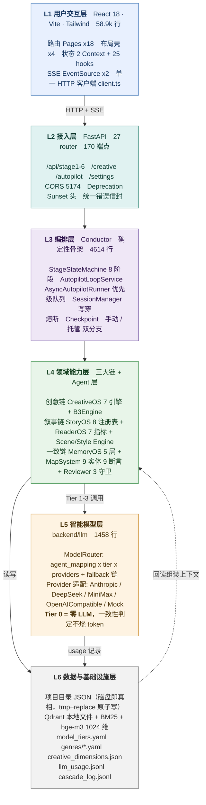
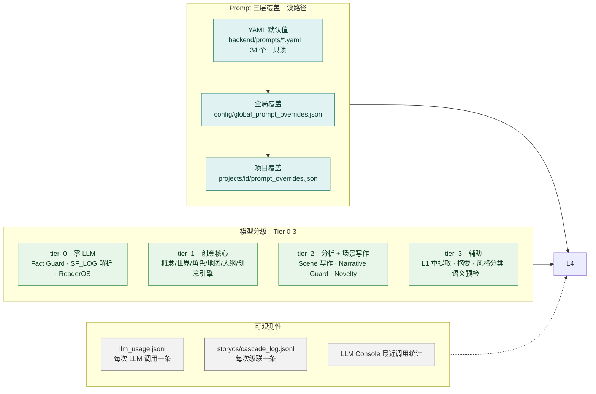
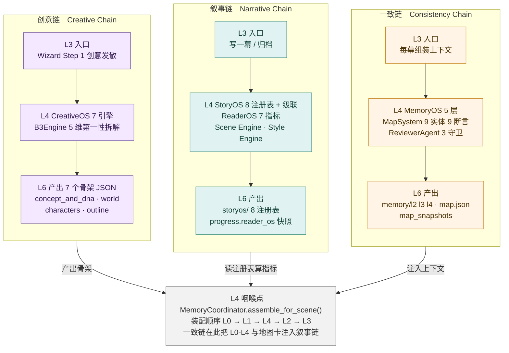
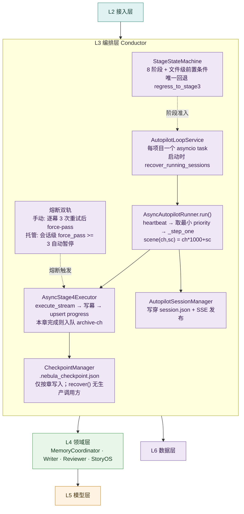
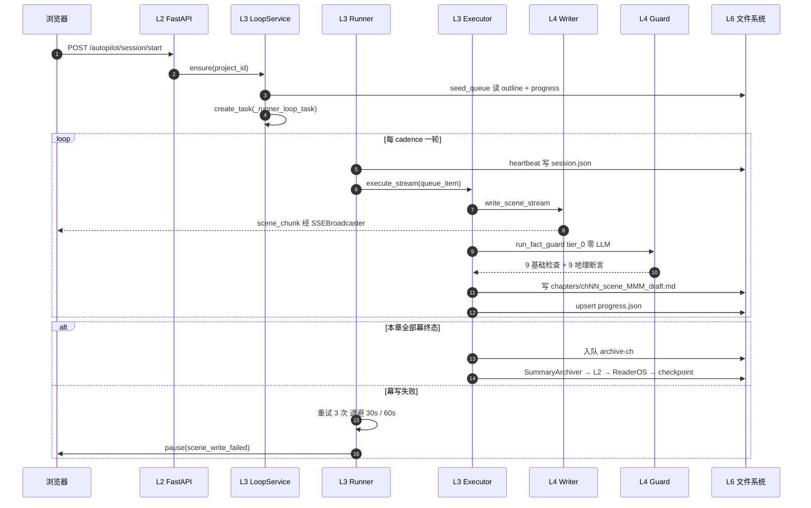
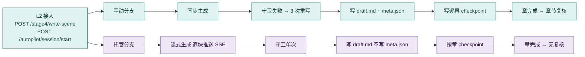
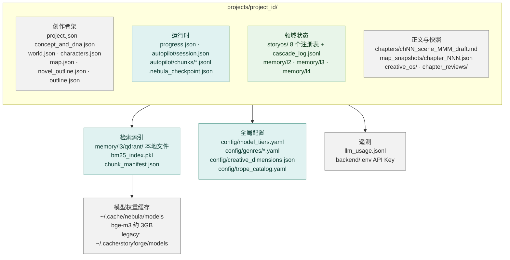
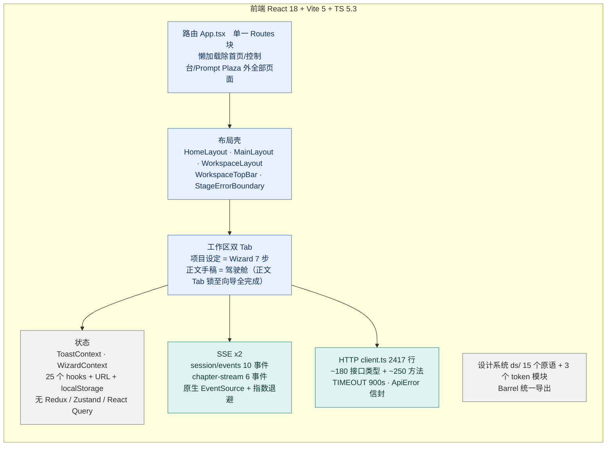
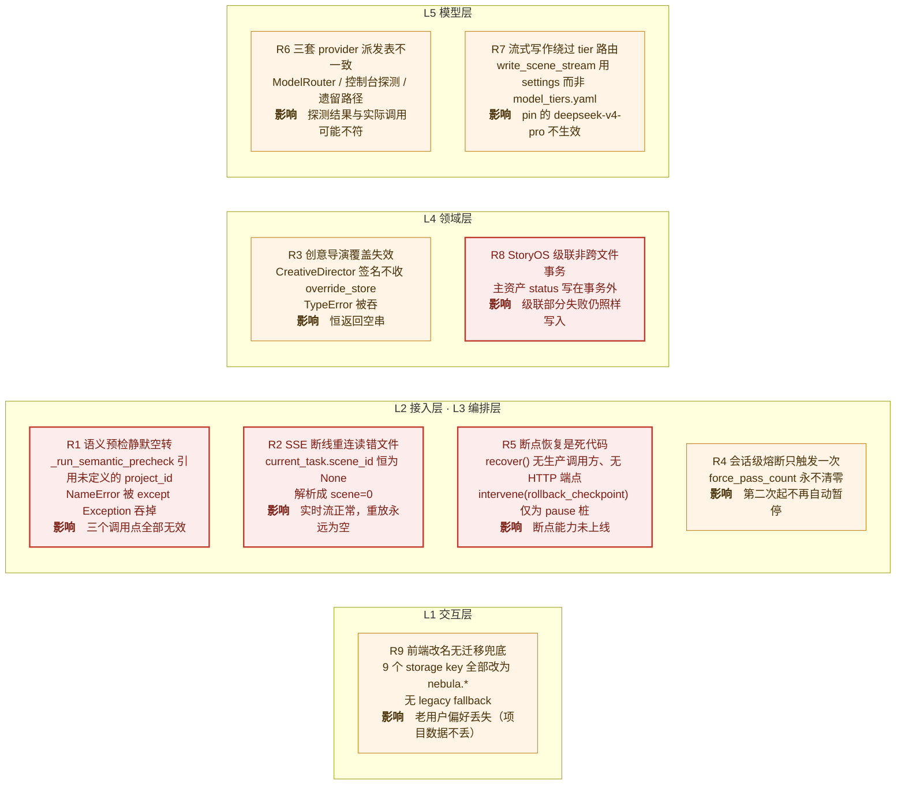
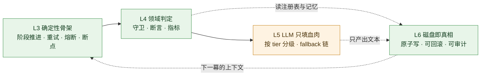

# nebula 产品应用架构分层图

> **定位**：本文只画**分层**与**数据流**。
> 创意流水线的逐阶段细节见 `docs/ARCHITECTURE.md`（Stage 0 → 3b）。
> Wizard 融合后的组件清单见 `docs/wizard-inventory.md`。
>
> 图中所有行数、端点数、阈值均取自当前工作树实测，非估算。
> 标注 ⚠ 的位置对应已验证的架构缺陷，见 §6。

---

## 0. 分层全景

六层。**上层只依赖下层，`api` 是唯一顶层，`models` 是唯一叶子**；中间层互不直接依赖，由 `api` 编排。

### 分层职责速查

| 层 | 职责 | 判定标准 | 关键产物 |
|---|---|---|---|
| **L1 交互** | 呈现与输入。无业务规则 | 组件里出现任何"规则判断"就是越界 | 路由、布局、状态、SSE 订阅 |
| **L2 接入** | 协议转换、鉴权、参数校验、错误信封 | 出现编排逻辑就是越界 | HTTP 契约 |
| **L3 编排** | **流程控制**：阶段推进、队列、重试、熔断、暂停恢复 | 出现领域计算就是越界 | 状态机、任务、session.json |
| **L4 领域** | **业务能力**：创作、叙事、一致性 | 出现"下一步做什么"就是越界 | 8 注册表、5 层记忆、9 断言 |
| **L5 模型** | 模型路由与适配 | 出现业务语义就是越界 | RoutingDecision、usage |
| **L6 数据** | 持久化与检索 | — | 项目目录 JSON、索引 |

> **分层的真正判据**：L3 与 L4 的边界是本项目最容易糊的地方。
> 「**下一幕该写什么**」属 L3；「**这一幕写得好不好、违不违规**」属 L4。
> `AsyncAutopilotRunner` 决定写第几幕 → L3；`ReviewerAgent.run_fact_guard` 判断这幕违不违规 → L4。

---

## 1. 横向切面：贯穿全层的三个关注点

这三样东西**不属于任何单层**，是横切关注点。

**关键点**：`tier_0` 的存在是整个架构的支点。
Fact Guard、SF_LOG 解析、ReaderOS 指标、地理断言**全部不调 LLM**——这就是「确定性代码管骨架」落地的位置，也是成本可控的根因。

**三级 Prompt 覆盖**的合并函数是 `load_prompt_effective()`（`backend/services/prompt_override_store.py:334`）：
YAML → 全局 → 项目，后者覆盖前者。S2 的 meta-decompose 正是利用项目级覆盖，把通用的 `firstness_decompose` 提示词换成**为本项目定制的版本**。

---

## 2. 能力链 × 分层落点

三条链不是三个目录，是三条**穿过不同层**的路径。

| | 创意链 | 叙事链 | 一致链 |
|---|---|---|---|
| **入口** | Wizard Step 1 创意发散 | 托管/手动写一幕 | 每一次场景组装 |
| **核心引擎** | CreativeOS 7 引擎 + B3Engine | StoryOS Agent + ReaderOS | MemoryCoordinator + Reviewer |
| **LLM 占比** | 高（tier_1 为主） | 中（tier_2 一段） | **极低**（tier_0 为主） |
| **产出** | 7 个 JSON 骨架 | 注册表状态 + 读者指标 | 上下文块 + 守卫结论 |
| **是否阻塞** | 否（可重生成） | 否（只建议） | **是**（Blocker 熔断） |

**一致性链是闭环的**：一致链把记忆与地图喂回叙事链，叙事链的产出再落回数据层被一致链读取。
三条链在 `MemoryCoordinator.assemble_for_scene()` 汇合——这是每幕写作的咽喉点。

---

## 3. 编排层内部：托管模式写一幕

### 3.1 编排层结构

### 3.2 一幕的端到端时序

### 3.3 手动模式与托管模式的差异

**不是同一套代码的两条路，是两套实现。** 差异集中在 L3 编排层与 L4 守卫层。

| | 手动模式 | 托管模式 |
|---|---|---|
| 入口 | `_write_scene_chapter()` 同步 | `_write_scene_chapter_stream()` 流式 |
| 事实守卫 | 3 次重试 + 熔断 force-pass | **单次**，失败直接 `force_passed` |
| 断点写入 | 逐幕 | **仅按章** |
| `*_meta.json` | 写 | **不写** |
| 章节复核 | 生成 | **不生成** |
| 熔断口径 | 逐幕 `CircuitBreaker` | 会话级 `force_pass_count >= 3` |
| SSE | 无 | 有（scene_chunk 逐 50 字 / 80ms 推送） |

> **架构含义**：托管模式放弃了「重写」与「复核」，换来吞吐。
> 这不是疏漏，是取舍——但代价是托管模式下 `ChapterReviewBuilder` 的输入（`*_meta.json`）根本不存在，
> 所以 Fact Guard 通过率在托管模式下**永远读不到数据**。

---

## 4. 数据与存储分层

磁盘即真相。**没有数据库**。

**原子写是全仓库硬约定**：所有 JSON 落地一律 `tmp 文件 → Path.replace()`。
崩溃不会留下半截文件。

**内存层级与磁盘层级一一对应**：

| 记忆层 | 磁盘位置 | 生命周期 | 装配时机 |
|---|---|---|---|
| L0 Runtime | 内存 | 单次请求 | 每幕 |
| L1 Hot | 内存（扫 `chapters/*.md` 重建） | 单次请求 | 每幕 |
| L4 Narrative | `memory/l4/narrative_patterns.json` | 持久缓存 | 每幕（**每次都重新同步 8 个注册表**） |
| L2 Warm | `memory/l2/` | 持久 | 每幕 |
| L3 Cold | `memory/l3/` | 持久 | 每幕（可缺席） |

装配顺序 **L0 → L1 → L4 → L2 → L3**，但注入提示词的顺序是
`实时上下文 → 近期章节摘要 → 全书叙事摘要 → 叙事模式分析(L4) → 相关历史文本(L3) → 创作阶段 → 地图卡`。
**L4 在提示词里排在 L3 前面**，与装配顺序不同。

---

## 5. 前端分层

**状态优先级是硬约定**：`useWorkspaceMode` = **URL › localStorage › 默认**。
URL 优先保证可分享链接能复现视图，localStorage 兜底个人偏好。

**没有全局 store** 是刻意的：项目是单用户本地应用，跨页面共享的状态很少，
引入 Redux 反而要处理持久化与失效。代价是跨页面的数据一致性靠各自 hook 重新拉取。

---

## 6. 架构风险落点

以下 9 条**已逐条验证**（非推测），标在图上的位置即修复位置。

### 风险明细

| # | 位置 | 根因 | 影响 | 状态 |
|---|---|---|---|---|
| **R1** | L2/L3 边界 `backend/api/stage4_writing.py:527` | `_run_semantic_precheck` 引用未定义的 `project_id`（既非参数也非模块全局），`NameError` 被 `except Exception` 吞掉 | 语义预检在**手动 / 托管 / fact-guard 三个调用点全部失效**，恒返回 `precheck_passed=True` | 已验证 |
| **R2** | L1/L3 `autopilot_runner_async.py:687` → `api/autopilot.py:452` | `current_task.scene_id` 硬编码 `None`，解析成 `scene=0`，SceneChunkStore 指向 `chNN_scene_000.jsonl` | 实时 SSE 正常，但 **`Last-Event-ID` 重连重放永远返回空** | 已验证 |
| **R3** | L4 `agents/creative_director.py:16` vs `api/creative_diverge.py:938/1051/1556` | 构造函数签名不收 `override_store` / `global_override_store`，`TypeError` 被吞 | `suggest_direction` / `recommend_mutation` **恒返回空串** | 已验证 |
| **R4** | L3 `conductor/autopilot_session.py:332` | `crossed = (count < 3 and new_count >= 3)`，而 `force_pass_count` 永不清零 | 会话级熔断**只会触发一次**；日志文案与代码相反 | 已验证 |
| **R5** | L3/L6 `conductor/checkpoint.py:103/183` | `recover()` 与 `restore_registries_from_snapshot()` 仅被测试调用，无 HTTP 端点 | 断点恢复能力**未上线**；真实恢复靠 `progress.json` + `outline.json` + `session.json` | 已验证 |
| **R6** | L5 `llm/model_router.py:547` / `services/llm_config.py:464` / `llm/__init__.py:47` | 三张 provider→class 派发表互不一致 | AI 控制台探测结果**可能与实际调用不符** | 已验证 |
| **R7** | L3→L5 `agents/base_agent.py:326` | 流式路径显式绕过 ModelRouter，用 `settings.llm_provider/llm_model` | `model_tiers.yaml` 里 pin 的 `deepseek-v4-pro` **对托管写作不生效** | 已验证 |
| **R8** | L4/L6 `story_os/registries.py:173` | 主资产 status 写入在 `propagate()` 事务之外，且级联部分失败时仍写入 | 跨注册表**可能部分应用**，无回滚 | 已验证 |
| **R9** | L1 前端 9 处 storage key | 改名时**未加 legacy fallback**（后端 checkpoint / Qdrant / bge-m3 缓存都加了） | 老用户的主题 / 侧栏宽度 / 折叠状态 / 向导进度**丢失** | 已验证 |

### 附：文档漂移（非缺陷，但会误导后续开发）

| 文档说法 | 代码实际 |
|---|---|
| 前端端口 5173 | **5174**（`vite.config.ts`，后端 CORS 也只放行 5174） |
| Tier 1 = Scene Writing | `writer.scene_writing` 在 **tier_2** |
| What-If depth=3 breadth=4 | `BRANCHES_PER_NODE = 3` |
| L1 = 最近 5 章 | `MAX_SCENES = 6` **幕** |
| `growth_curve/auto_generator.py` | 该文件不存在，已被 `aligner.py` 取代 |
| L2 约 8K token | `get_context_string(max_tokens=8000)` **参数收了没用** |

### 附：结构性不一致

- **两套测试目录**：根 `tests/`（~140 文件）与 `backend/tests/`（46 文件），风格不同。
- **三套创意发散并存**：`creative_divergence.py`（已废弃，`_generate_variants` 是确定性 stub 不调 LLM）/ `creative_diverge.py`（v1.x，3357 行）/ `v2_canvas.py`（v2，836 行）。
- **两套突变词汇**：`MutationOp`（inversion/fusion/escalation/subversion）vs canvas 6 ops（twist/break/fuse/invert/escalate/dramaturgy）。
- **`REGISTRY_FILES` 字面量复制三份**（`registries.py` / `registry_transaction.py` / `l4_narrative.py`）。
- **Stage 前置条件文件号错位一位**：STAGE2 检查 `concept_and_dna.json`，STAGE3 检查 `characters.json` + `world.json`。
- **STAGE5 / STAGE6 前置条件空集合恒真**（`all()` 作用于空列表）。

---

## 7. 一张图收尾：为什么这套架构能撑住长篇

**核心：LLM 出现在链尾且被夹在中间。**
它既不决定「写什么」（L3），也不决定「对不对」（L4），只负责把已经定好的骨架变成文字。
所以：

- LLM 挂了 → tier_2/3 降级为空串，**流程不崩**（`base_agent.py:411` 静默降级）
- 写崩了 → 断点 + 队列 + 熔断，**可恢复**
- 判定永远一致 → 因为判定根本不经 LLM

代价是**托管模式为了吞吐放弃了重写与复核**（§3.3），这是当前架构最锋利的一处取舍。

---

*所有图块已通过 `node scripts/check_mermaid.mjs docs/ARCHITECTURE-LAYERS.md` 校验（用 frontend 已安装的 mermaid v12 离线解析）。*
*布局经验（写新图时省得踩坑）：mermaid 在子图**内部节点对外连线**时会忽略子图内的 `direction`；*
*改成**子图 ID 对外连线**即可保留方向；多个并列子图指向同一节点时会自动排成一行。*
